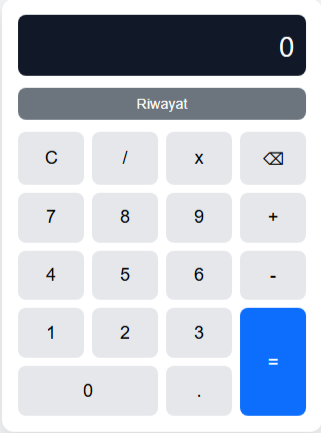
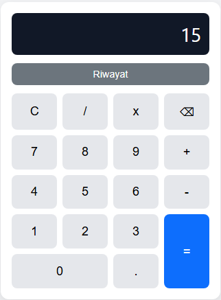
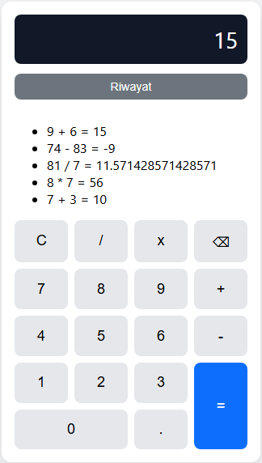
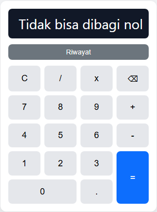
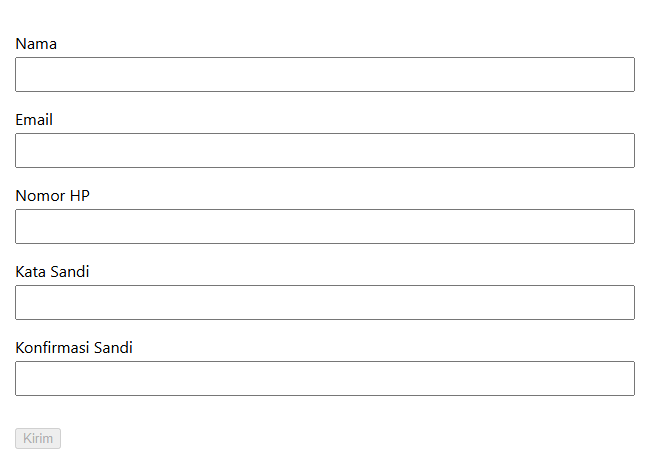
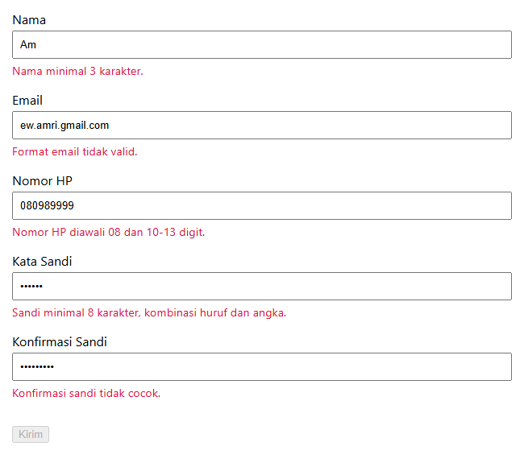
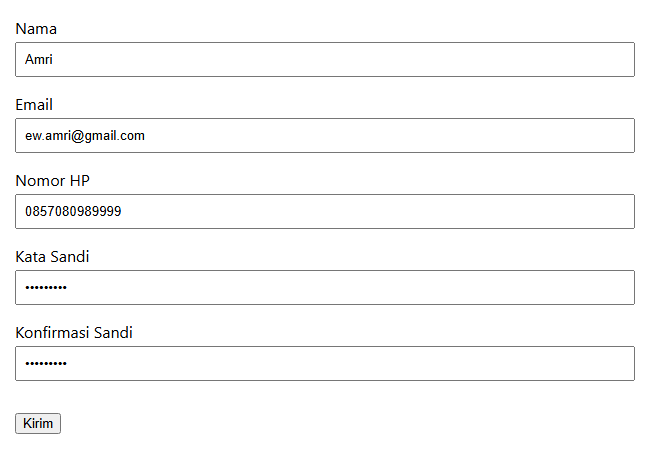
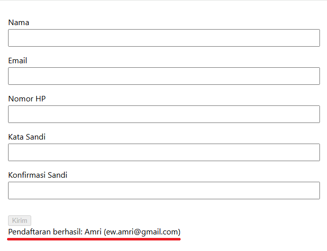

# Proyek 2 - Kalkulator dan Form Validator

Proyek ini dibuat sebagai bagian dari praktikum Hari 5 Junior Web Programmer. Proyek terdiri dari dua aplikasi berbasis JavaScript, yaitu Kalkulator Modular dan Form Validator dengan penerapan ES Module (`export` dan `import`).

---

# Struktur Folder

```text
proyek-2-kalkulator
│
├── kalkulator
│   ├── index.html
│   ├── css
│   │   └── style.css
│   └── js
│       ├── operasi.js
│       └── app.js
│
├── validator
│   ├── index.html
│   ├── css
│   │   └── style.css
│   └── js
│       ├── aturan.js
│       └── app.js
│
└── README.md
```

---

# Bagian A - Kalkulator Modular

Aplikasi kalkulator berbasis JavaScript dengan pemisahan logika dan antarmuka menggunakan ES Module.

## Fitur

- Operasi tambah, kurang, kali, dan bagi
- Tombol angka dan desimal
- Tombol clear (C)
- Tombol hapus satu karakter (⌫)
- Penanganan pembagian dengan nol
- Riwayat 5 perhitungan terakhir
- Dukungan keyboard
- Layout menggunakan CSS Grid

## Dukungan Keyboard

| Tombol | Fungsi |
|---------|---------|
| 0-9 | Input angka |
| . | Input desimal |
| + | Penjumlahan |
| - | Pengurangan |
| * | Perkalian |
| / | Pembagian |
| Enter | Hitung hasil |
| Delete | Hapus satu karakter |
| Escape | Reset kalkulator |

## Tangkapan Layar

### Tampilan Awal Kalkulator



### Operasi Perhitungan



Contoh:

```text
9 + 6 = 15
```

### Riwayat Perhitungan



### Pembagian dengan Nol



Contoh:

```text
5 / 0
```

Output:

```text
Tidak bisa dibagi nol
```

---

# Bagian B - Form Validator

Aplikasi validasi formulir pendaftaran akun dengan validasi real-time menggunakan JavaScript Modular.

## Fitur

- Validasi nama
- Validasi email
- Validasi nomor HP
- Validasi kata sandi
- Validasi konfirmasi sandi
- Pesan validasi real-time
- Tombol kirim aktif hanya jika seluruh data valid
- Ringkasan pendaftaran setelah submit
- Penggunaan `textContent` untuk keamanan data

## Aturan Validasi

### Nama

```text
Minimal 3 karakter
```

### Email

```text
Format email harus valid
```

### Nomor HP

```text
Diawali 08
Panjang 10-13 digit
```

### Kata Sandi

```text
Minimal 8 karakter
Mengandung huruf
Mengandung angka
```

### Konfirmasi Sandi

```text
Harus sama dengan kata sandi
```

## Tangkapan Layar

### Tampilan Awal Form



### Validasi Data Tidak Valid



### Form Valid dan Tombol Kirim Aktif



### Ringkasan Pendaftaran Berhasil



Contoh:

```text
Pendaftaran berhasil:
Amri (amri@email.com)
```

---

# Teknologi yang Digunakan

- HTML5
- CSS3
- JavaScript ES6+
- DOM Manipulation
- Event Handling
- ES Module (`export` dan `import`)
- CSS Grid
- Live Server

---

# Cara Menjalankan

## Kalkulator

Buka:

```text
kalkulator/index.html
```

menggunakan Live Server.

## Form Validator

Buka:

```text
validator/index.html
```

menggunakan Live Server.

---

# Catatan

Modul ES menggunakan `import` dan `export` sehingga aplikasi harus dijalankan melalui web server seperti Live Server. Jika dibuka menggunakan:

```text
file:///
```

browser akan memblokir pemuatan modul karena kebijakan keamanan (CORS).

---

# Pengembang

Dibuat untuk memenuhi tugas PBL Hari 5 - Fungsi, Array, DOM, dan Modularisasi pada pelatihan Junior Web Programmer.