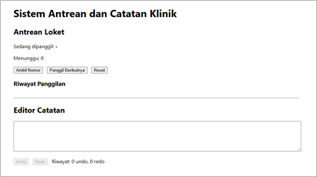
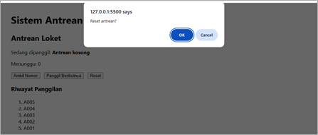
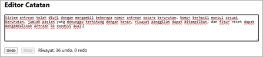
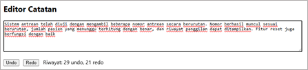
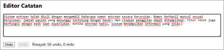

# Proyek 3 - Simulator Antrean dan Riwayat

Proyek ini dibuat sebagai implementasi Struktur Data, Algoritma, dan Clean Code pada pelatihan Junior Web Programmer. Aplikasi terdiri dari dua fitur utama, yaitu simulasi antrean loket menggunakan Linked Queue dan editor catatan dengan fitur Undo/Redo menggunakan Stack.

---

# Struktur Folder

```text
proyek-3-antrian
│
├── index.html
├── README.md
│
├── css
│   └── style.css
│
└── js
    ├── structures.js
    ├── antrian.js
    ├── riwayat.js
    └── app.js
```

---

# Fitur A - Antrean Loket

## Fitur

- Ambil nomor antrean otomatis
- Nomor antrean berurutan (A001, A002, A003, ...)
- Pemanggilan antrean menggunakan prinsip FIFO
- Menampilkan jumlah antrean yang menunggu
- Menampilkan daftar antrean yang masih menunggu
- Menampilkan 5 nomor terakhir yang sudah dipanggil
- Tombol Reset antrean
- Konfirmasi sebelum reset antrean
- Pesan antrean kosong

## Struktur Data

```text
LinkedQueue
```

## Alasan Pemilihan

Operasi antrean membutuhkan:

```text
enqueue()
dequeue()
```

secara cepat.

LinkedQueue memungkinkan kedua operasi tersebut dilakukan dengan kompleksitas O(1).

## Tangkapan Layar

### Tampilan Awal Antrean



### Mengambil Nomor Antrean


### Memanggil Nomor Antrean


### Antrean Kosong


### Reset Antrean




---

# Fitur B - Editor Catatan dengan Undo/Redo

## Fitur

- Menulis catatan
- Undo perubahan
- Redo perubahan
- Tombol nonaktif saat stack kosong
- Riwayat maksimal 50 langkah
- Debounce saat mengetik
- Menampilkan jumlah riwayat Undo dan Redo
- Menyimpan catatan terakhir menggunakan localStorage

## Struktur Data

```text
Stack
```

## Alasan Pemilihan

Perubahan terakhir harus menjadi perubahan pertama yang dibatalkan.

Prinsip tersebut sesuai dengan:

```text
LIFO
(Last In First Out)
```

yang digunakan oleh Stack.

## Tangkapan Layar

### Editor Catatan


### Undo Perubahan



### Redo Perubahan



### Riwayat maksimal



---

# Cara Menjalankan

Buka folder proyek menggunakan Visual Studio Code.

Jalankan:

```text
Open With Live Server
```

atau:

```text
Go Live
```

pada file:

```text
index.html
```

---

# Pengujian

## Antrean Loket

### Skenario

Pengujian dilakukan dengan menambahkan beberapa nomor antrean, memanggil nomor secara bertahap, serta menguji kondisi saat antrean sudah habis dan saat antrean direset.

### Hasil

Sistem berhasil menampilkan nomor antrean sesuai urutan kedatangan, memperbarui jumlah antrean yang menunggu, menampilkan riwayat panggilan, serta memberikan informasi yang jelas ketika antrean sudah kosong.

---

## Editor Undo/Redo

### Skenario

Pengguna menuliskan beberapa catatan, melakukan perubahan isi catatan, membatalkan perubahan, mengembalikan perubahan, dan melanjutkan pengetikan kembali.

### Hasil

Fitur Undo dan Redo berjalan dengan baik sesuai riwayat perubahan yang tersimpan. Sistem juga berhasil memperbarui jumlah riwayat, menghapus riwayat Redo ketika pengguna membuat perubahan baru, serta menyimpan catatan terakhir yang dibuat.

---

## Editor Undo/Redo

### Skenario

Ketik:

```text
Junior Web Programmer
```

Lakukan:

```text
Undo 3 kali
Redo 2 kali
```

Kemudian ketik kembali.

### Hasil

Riwayat Redo terhapus dan editor melanjutkan riwayat baru sesuai perubahan pengguna.

---

# Alasan Pemilihan Struktur Data

| Kebutuhan | Struktur Dipilih | Alasan | Alternatif dan Mengapa Tidak Dipilih |
|------------|------------|------------|------------|
| Antrean pasien | LinkedQueue | enqueue dan dequeue O(1) | Array + shift karena membutuhkan O(n) |
| Riwayat Undo/Redo | Stack | Perubahan terakhir dibatalkan lebih dulu | Queue karena urutan proses tidak sesuai |
| Riwayat 5 panggilan terakhir | Array dibatasi panjang | Sederhana dan mudah ditampilkan | LinkedList karena terlalu kompleks untuk data yang sedikit |

---

# Teknologi yang Digunakan

- HTML5
- CSS3
- JavaScript ES Module
- Linked List
- Queue
- Stack
- Local Storage
- ESLint
- Prettier

---

# Pengembang

Dibuat sebagai Proyek 3 pada pelatihan Junior Web Programmer.