# Proyek 4 - Buku Tamu Berbasis File

## Deskripsi

Aplikasi buku tamu berbasis PHP tanpa database. Data tamu disimpan ke file JSON dan dapat dicari berdasarkan nama.

## Struktur Folder

```text
proyek-4-buku-tamu
│
├── index.php
├── functions.php
├── admin.php
├── export-csv.php
├── README.md
│
└── data
    ├── .htaccess
    ├── tamu.json
    └── ip-log.json
```

## Cara Menjalankan

1. Jalankan Apache melalui XAMPP.
2. Simpan proyek di folder htdocs.
3. Buka browser.
4. Akses: 
  - Buku tamu  
  http://localhost/hari-08/proyek-4-buku-tamu/index.php
  - Admin  
  http://localhost/hari-08/proyek-4-buku-tamu/admin.php

## Fitur

- Validasi data tamu.
- Penyimpanan data ke JSON.
- Pencarian berdasarkan nama.
- Pesan terbaru tampil di bagian atas.
- Paginasi data.
- Pembatasan pengiriman pesan 30 detik per IP.
- Hapus pesan melalui halaman admin.
- Ekspor data CSV.

## Dokumentasi Screenshot

### Form buku tamu.
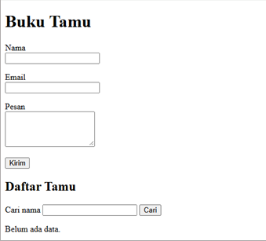
### Validasi nama.
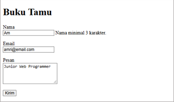
### Validasi email.
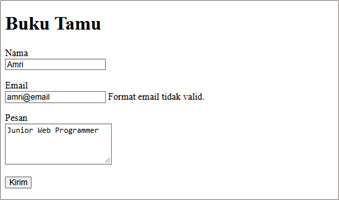
### Validasi pesan.
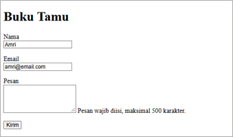
### Pesan berhasil disimpan.
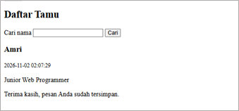
### Isi file tamu.json.
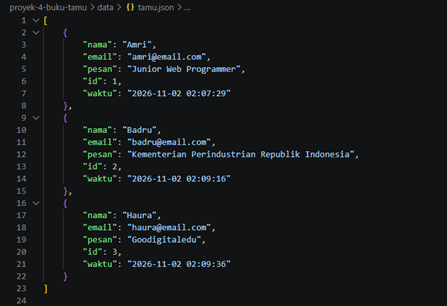
### Daftar tamu.
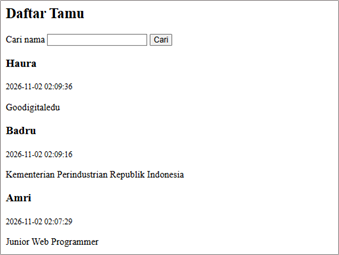
### Hasil pencarian nama.
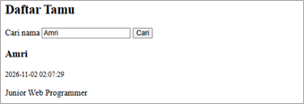

### Paginasi daftar tamu.
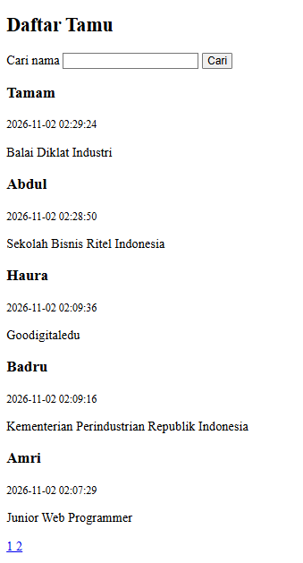
### Peringatan batas 30 detik per IP.
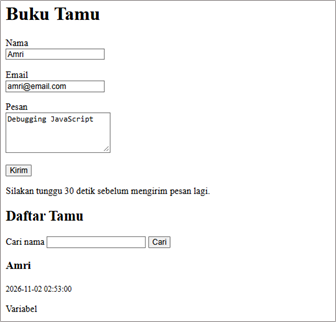
### Halaman admin.
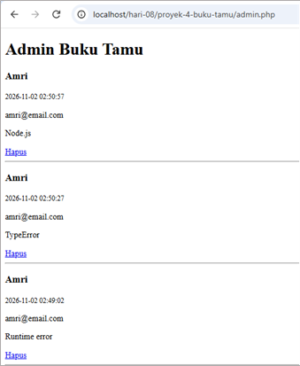
### Konfirmasi hapus pesan.
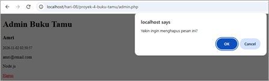
### Data setelah dihapus.
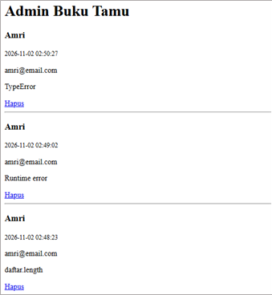
### Ekspor data CSV.
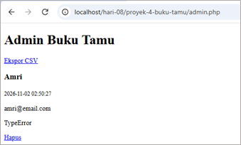
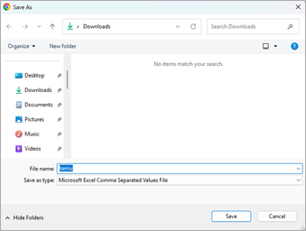
### File tamu.csv hasil ekspor.
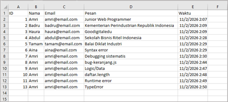